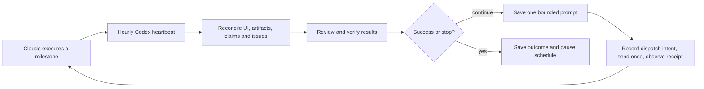

# Claude ↔ Codex Autonomous Loop

A reusable Codex skill for the loop:

**Claude Code runs a calculation → Codex checks hourly → reconciles and critically
reviews the evidence → sends one next prompt → repeats until verified success or
a stopping condition.**

Derived from a working convex-hull research workflow. The reusable skill keeps
its persistent ledger and marked prompts, adding configurable criteria, limits,
artifact checkpoints and explicit claim/issue reconciliation.



## Install and start

Install this repository's folder as `claude-codex-loop` in your client's skill
directory. For clients using the current `.agents/skills` convention, from the
repository root:

```bash
mkdir -p "$HOME/.agents/skills"
ln -s "$PWD" "$HOME/.agents/skills/claude-codex-loop"
```

Some clients discover `~/.codex/skills`; use your client's directory. Do not replace
an existing skill at the destination. Claude does not need the skill installed.

Then ask Codex:

> Use $claude-codex-loop for /work/my-calculation and my existing Claude Code
> conversation “My calculation,” session SESSION_ID. Review every hour and
> automatically send follow-up prompts. Stop when [specific evidence-based success
> condition]. Limit the run to 20 prompts, 48 hours, and 3 consecutive reviews
> without verified progress. Keep the work within this local project.

Codex records the scope and criteria, adopts the current calculation, performs a
first tick, and creates a same-chat hourly schedule using the available tool.
Routine rounds need no further confirmation. Installation itself starts nothing.
See [setup](references/setup.md) for configuration, commands, dependencies and limits.

## Reconciliation is part of every round

- Compare the ledger with the **actual Claude conversation**, sent marker and final
  response. Never infer completion from an inactive file or a handoff's PASS label.
- Hash selected inputs, code and outputs. If files change after review, require a
  fresh review before sending the next prompt.
- Link each review to its predecessor by hash. Carry forward every claim and issue
  ID, recording corrections, retractions and resolutions explicitly.
- Require evidence for every success criterion; an open blocking issue prevents
  success. A budget limit is recorded as an incomplete stop.
- Freeze prompt text and persist `submitting` before touching the UI. Recover an
  uncertain submission by observing its marker. Never replay it blindly.
- Use leases and atomic local writes to coordinate overlapping or interrupted ticks.

This is a cooperative workflow with crash recovery. It cannot establish truth from
two model opinions, guarantee exactly-once UI delivery, sandbox project code, or
enforce dollar budgets. Its drift coverage is limited to configured watched files.

## Requirements and current validation

The desktop workflow needs a same-chat scheduling tool, supported computer use
that can operate Claude's UI, authenticated Claude Code/Codex sessions, and Python
3.10+ on macOS/Linux. Keep the local host and desktop app running. This repository
does not install those tools, introduce an API runner, or bypass approvals/logins.
Availability varies by client. [Official scheduling documentation](https://learn.chatgpt.com/codex/automations)
describes same-chat schedules and local-host requirements.

The source workflow has run on a real convex-hull project. The generalized
controller is validated with isolated, simulated UI observations and temporary
projects, covering interrupted sends, concurrent ownership, drift, stale evidence,
claim continuity and stopping behavior. This is not an end-to-end demonstration
on every desktop client. Tests never send a live Claude prompt.

Local validation on 2026-10-17: **28 tests passed** on macOS with Python 3.14.6,
and the Codex skill validator passed. GitHub Actions is configured for macOS/Linux
with Python 3.10/3.12; those CI jobs have not yet run for this repository.

```bash
python3 -m unittest discover -s tests -v
```

## Package contents

| File | Purpose |
| --- | --- |
| [SKILL.md](SKILL.md) | Codex entry point and autonomous tick procedure |
| [scripts/control.py](scripts/control.py) | Dependency-free persistent state controller |
| [references/setup.md](references/setup.md) | Installation, configuration, portability and limits |
| [references/protocol.md](references/protocol.md) | Commands, evidence formats and recovery |
| [assets](assets) | Config, review and next-prompt templates |
| [tests](tests) | Isolated controller integration tests |

Runtime state belongs in a private supervisor directory outside Claude's project
and outside this skill repository. Do not publish actual transcripts, identifiers,
prompts, credentials or research artifacts with the reusable package.

Licensed under the [MIT License](LICENSE).
