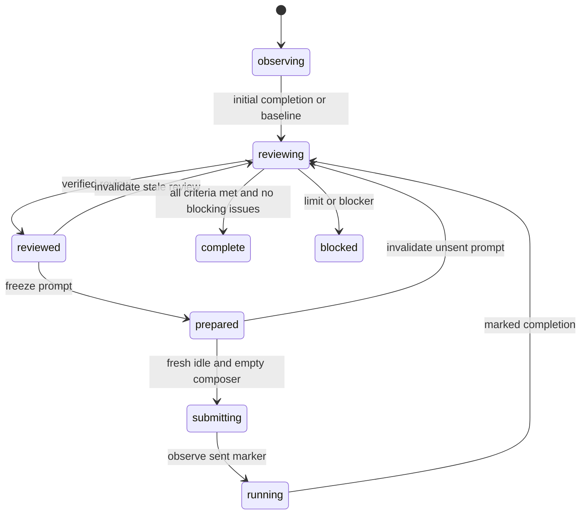

# Tick commands, evidence, and recovery

Every command uses the same absolute script and private supervisor root:

```bash
python3 /path/to/claude-codex-loop/scripts/control.py --root /work/supervisor status
```

Below, `control` abbreviates that prefix; it is not an installed command. Read returned
phase/enabled fields before dependent actions. Exit 2 is a validation error without
a state commit. A successful command can disable a loop when limits are reached;
exit 0 alone never authorizes a send.

## Commands

| Command | Purpose |
| --- | --- |
| `init --config FILE` | Create a fresh ledger; never reset one. |
| `status` | Read phase, scope, limits, lease and next marker. |
| `reconcile` | Hash watched files; show changed paths, artifact hash and previous review hash. |
| `acquire` | Take a lease; retain returned `lease.token` as TOKEN for this tick. |
| `renew --token TOKEN` | Extend a valid lease during a long review. |
| `release --token TOKEN` | Release this tick's lease. |
| `completed --token TOKEN --evidence FILE` | Record an idle final response or initial empty-session baseline. |
| `review --token TOKEN --report FILE` | Commit evidence, criteria, claims, issues and checkpoint. |
| `prepare --token TOKEN --prompt FILE` | Freeze a marked next prompt after a current review. |
| `prompt` | Print exact frozen text for Claude. |
| `submitting --token TOKEN --evidence FILE` | Persist intent before touching the empty composer. |
| `running --token TOKEN --evidence FILE` | Record an observed sent-marker receipt. |
| `invalidate --token TOKEN --reason TEXT` | Return a reviewed/unsent prepared milestone to review. |
| `block --token TOKEN --reason TEXT` | Disable dispatch, retaining the interrupted phase. |
| `stop --reason TEXT` | User stop; needs no lease and revokes any existing lease. |
| `resume --reason TEXT` | User-directed continuation, preserving phase and limits. |
| `heartbeat` | Print a durable schedule prompt; schedule nothing. |

`status`, `reconcile`, `prompt`, `heartbeat` are read-only. Do not reuse an expired,
released or revoked token. Expiry permits a new tick to reconcile; it never resets
`submitting` to `prepared`.

## Phases



Stop/block can disable any active phase while retaining it for resume. Success is
evaluated during review before further-dispatch limits, permitting a final result
at the round limit.

## UI observations

Save fresh numbered files in `observations/`, using supported live UI reads. Record
the actual observed target identity, not just copied config. `observed_at` is Unix
seconds (`time.time()` in Python); older than five minutes or future is rejected.

```json
{
  "claude_title": "Curve calculation",
  "claude_session": "ACTUAL_OBSERVED_SESSION",
  "observed_at": 1792278000,
  "marker": "[CCL-RUNID-0001]",
  "detail": "Describe exact target identity and what the UI actually showed.",
  "idle": true,
  "final_response_seen": true,
  "composer_empty": true,
  "sent_marker_seen": false
}
```

Generate actual timestamps/markers. Set booleans only when supported by observation:
`completed` needs idle and final response; `submitting` needs idle/empty composer;
`running` needs a marker in a **sent user message**. Nonzero rounds require the
pending marker. Before sending, `marker` names the candidate round, not a receipt.
Round zero has no required marker. For an initially empty idle conversation, use
`baseline_ready: true` with `composer_empty: true` and explain the empty session in
`detail`; this exception is valid only during initial `observing` at round zero.

## Reviews

Save prose in `reviews/0000.md` plus JSON based on
[review.example.json](../assets/review.example.json). After actual verification:

1. Let watched outputs settle; run `reconcile`. Put its `artifact_sha256` and
   `previous_review_sha256` into the report. The first previous hash is `null`.
2. Compare changes, previous review and Claude's actual response. Explain invalidated
   assumptions, contradictions and corrections in `reconciliation`.
3. Carry forward every prior claim/issue ID. Resolve issues explicitly. Keep
   retracted claims as `refuted`/`uncertain` with reasons; never quietly change a
   claim's meaning. The controller preserves statement text for existing IDs. For
   a revised scope, add a new ID and explicitly qualify/retract the original.
   Revalidate accepted claims whose dependencies changed.
4. Record checks actually performed with method/command, observed result and source
   path/URL. Assess every configured criterion as `met`, `not_met`, or `unknown`
   with evidence. Unknown fails. Any open issue with `blocking: true` prevents success.
5. Set `progress` by verified movement toward the goal. Ruling out an approach can
   count with evidence; file churn alone cannot. Choose one bounded next milestone.

The controller rejects stale hashes, changed watched files, missing criteria and
dropped claim/issue IDs. If verification changes outputs, review those changes before
using the final hash. Hash identity is not proof of correctness.

## Recovery

| Observation | Action |
| --- | --- |
| Claude working, ledger observing/running | Leave UI alone; release lease; retry later. |
| Prepared, current artifacts, exact idle empty target | Begin the single dispatch procedure. |
| Submitting, marker in a sent user message | Record running; never send. Review if completed. |
| Submitting, absent marker/draft/ambiguous UI | Block; never replay even if crash probably preceded Send. |
| Running, marked final response finished | Read response/artifacts, record completed, review. |
| Artifacts changed before submission | Invalidate and re-review; regenerate the unsent prompt. |
| Claim contradicted or evidence removed | Revise claim register, reopen affected issues, repair. |
| Unexpected human prompt, target mismatch, approval/login/limit | Preserve target/draft, block, notify once. |
| Temporary app unavailability | Release lease; preserve dispatch state; retry later. |
| Time limit while Claude works | Block future dispatch, pause schedule, leave calculation alone. |

Do not attribute someone else's final response to this round. A handoff file alone
never proves completion. If tracked response identity is unclear, block. Ledger
history commits atomically with state and retains frozen prompts, reviews and
observations. This supports cooperative crash recovery, not protection from a
hostile process editing the ledger.
